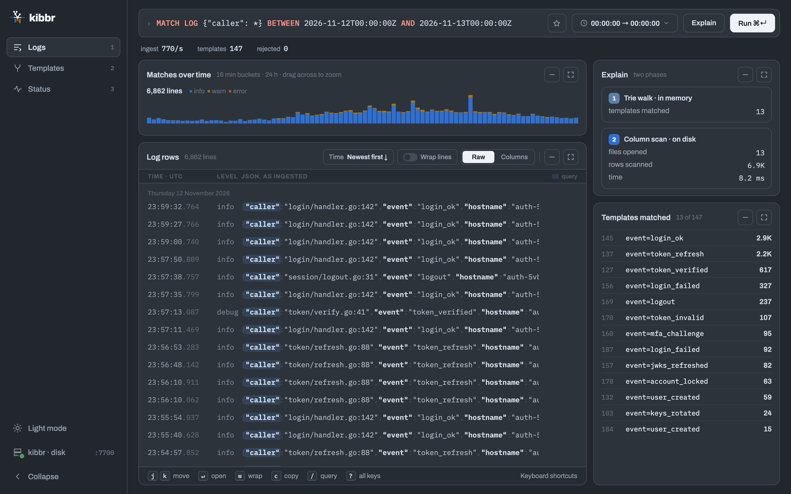

<p align="center">
  <picture>
    <source media="(prefers-color-scheme: dark)" srcset="docs/img/logo-dark.svg">
    <source media="(prefers-color-scheme: light)" srcset="docs/img/logo-light.svg">
    
  </picture>
</p>

# kibbr: a log store for structured JSON logs

[](https://crates.io/crates/kibbr)
[](LICENSE)

**kibbr stores structured JSON logs in a fraction of their size and keeps them queryable. One static binary, written in Rust.**

For example, 69.6 GB of real MongoDB server logs take 366 MB.

<picture>
  <source media="(prefers-color-scheme: dark)" srcset="docs/img/console-results.png">
  <source media="(prefers-color-scheme: light)" srcset="docs/img/console-results-light.png">
  
</picture>

## Results

Five public log datasets, measured with kibbr 0.4 on one AWS c7i.2xlarge.

| Dataset | Raw | gzip -9 | zstd -19 | kibbr | Ratio |
|---|---:|---:|---:|---:|---:|
| Elasticsearch server logs | 8.57 GB | 158.9 MB | 78.1 MB | **41.4 MB** | 207 : 1 |
| MongoDB server logs | 69.58 GB | 1.37 GB | 772.8 MB | **366.3 MB** | 190 : 1 |
| PostgreSQL jsonlog | 0.41 GB | 14.0 MB | 11.2 MB | **9.5 MB** | 43 : 1 |
| HDFS logs | 7.19 GB | 419.4 MB | **213.1 MB** | 217.0 MB | 33 : 1 |
| CockroachDB logs | 10.51 GB | 515.6 MB | **291.4 MB** | 343.5 MB | 31 : 1 |

The smallest size in each row is in bold. kibbr is smaller than gzip -9 on all five and smaller than zstd -19 on three, and unlike either you can query what it stores.

How it was measured, where it loses and why, and how to reproduce it: [docs/benchmarks.md](docs/benchmarks.md).

## Where it fits


kibbr is for the months between a hot search cluster and an archive nobody can query.

## Try it in a minute

```sh
$ cargo install kibbr        # needs Rust 1.96.1 or newer

$ kibbr gen-logs --profile farm --lines 10000 --seed 42 > day.ndjson
$ kibbr serve --data-dir kibbr-data

$ curl -s -X POST --data-binary @day.ndjson http://127.0.0.1:7700/ingest
{"ok":true,"ingested":10000,"errors":[]}

$ curl -s -X POST -d '{"q": "COUNT LOG {\"event\": \"login_ok\"}"}' http://127.0.0.1:7700/query
{"exists":true,"count":113, ... "duration_ms":3.58}
```

Open **http://127.0.0.1:7700/** for the built-in web console.

There is also a [Docker image](docs/container.md), and [compaction](docs/compact.md) shrinks a finished day.

## Queries

kibbr has its own small query language, TrieQL. The same queries run over HTTP, from the command line and in the console.

| To ask | Write |
|---|---|
| Errors in the last 6 hours, in 5-minute buckets | `COUNT LOG {"level": "error"} SINCE 6h GROUP BY time(5m)` |
| The newest 200 failed logins from the last hour | `MATCH LOG {"event": "login_failed"} SINCE 1h LIMIT 200` |
| One job by its id | `MATCH LOG {"job.id": "j_4821"}` |
| A day of lines by level, hour by hour | `COUNT LOG {} SINCE 1d GROUP BY time(1h), level` |
| Logins in a fixed window | `COUNT LOG {"event": "login_ok"} BETWEEN 2024-01-15T09:00:00Z AND 2024-01-15T12:00:00Z` |

The full language is in [docs/serve.md](docs/serve.md).

## How it works

Every structured log line is two things: a **shape**, meaning which keys it has, and **values**.

```
{"ts":"2024-01-15T09:12:03Z","level":"info","event":"login_ok","user":"u_812","ms":41}

shape   {ts, level, event, user, ms}            → stored once, in a trie in memory
values  2024-01-15T09:12:03Z  info  login_ok  u_812  41
                                                → appended to typed columns on disk
```

An application emits thousands of lines but only dozens of shapes. kibbr keeps each shape once and writes its values as typed columns. A query walks the trie first, skips the shapes that can't match without touching disk, and scans only the columns that can.

## What you can rely on

- **Acknowledged lines are kept.** A `200` from `/ingest` means every line is in the write-ahead log and flushed. This is tested by killing the process mid-write.
- **You get the same JSON back.** The same values, with keys sorted and rows in time order.

## What it is not for

- **Free text.** kibbr needs structured JSON. Long message bodies come out about the size of a zstd -19 file, or larger, and there is no substring search across every field.
- **Shifting key sets.** Every new key set is stored as a new shape. Logs that use data as keys come out larger than raw (Spark event logs do), and an optional field makes two shapes until schema merging is built.
- **Elasticsearch tooling.** kibbr has its own query language, HTTP API and console, and no Elasticsearch-compatible API.

## Docs

More in [docs/](docs), starting with [docs/serve.md](docs/serve.md). Website: **https://pratyaydeep.github.io/kibbr/**. Crate API: [docs.rs](https://docs.rs/kibbr).

## Status

kibbr is under development. It runs, it measures, and it isn't finished:

- Speed has not been benchmarked on a server yet. The benefit measured so far is space.
- Schema merging and a cold S3 tier are designed but not built.

The most useful thing you can do is run `kibbr bench-storage your-logs.ndjson` and [open an issue](https://github.com/pratyaydeep/kibbr/issues) with what it prints, good or bad.

## Licence

AGPL-3.0-only. You can run it for your own logs freely; if you modify it and offer it as a service, you must publish your changes. Contributions are accepted under MIT ([LICENSE-CONTRIBUTOR](LICENSE-CONTRIBUTOR)), and other terms are in [COMMERCIAL.md](COMMERCIAL.md).
