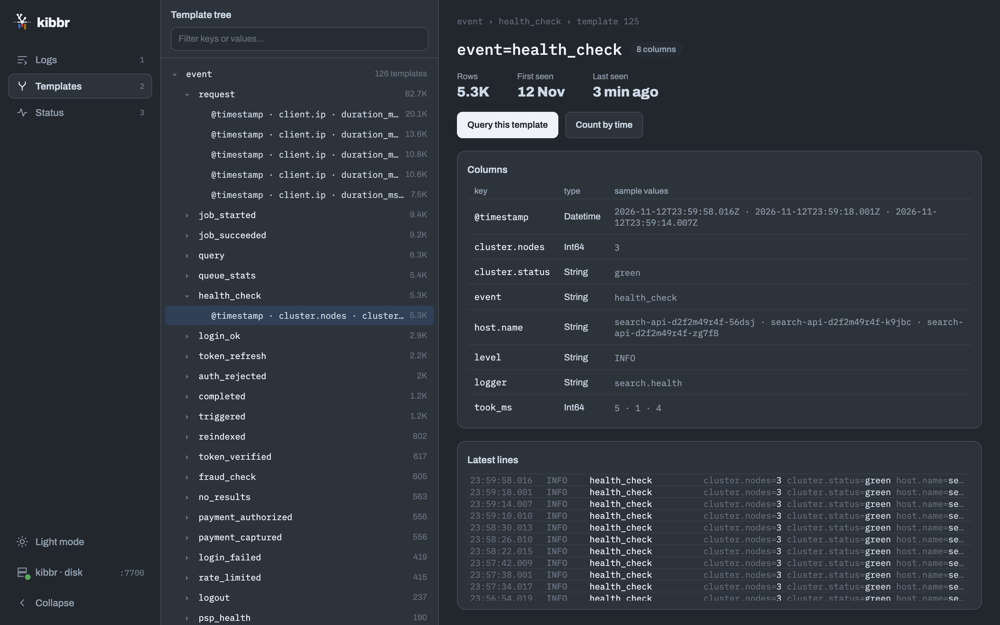
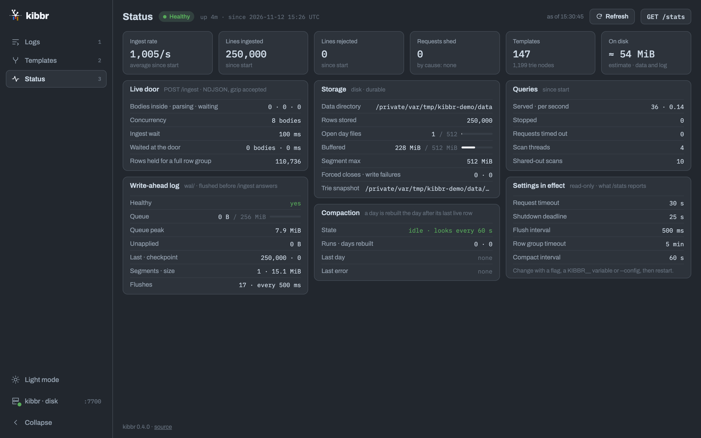

# Look at kibbr in a browser

```
kibbr serve --data-dir kibbr-data     # then open http://127.0.0.1:7700/
```

`GET /` is the web console: three pages over the server's own API.

- **Logs** (`#/`): one search box, suggestions drawn from the template tree, and the queries
  run from this browser. Running a query opens its results (`#/?q=<query>`): matches over
  time, the log rows, how the query ran (Explain), and the templates it touched.
- **Templates** (`#/templates`, `#/templates/<id>`): every template as a tree, and one
  template's columns and latest lines.

  

- **Status** (`#/status`): health, ingest, the write-ahead log, storage, compaction, queries
  and the settings in effect, every value from `GET /stats` and `GET /health`.

  

Routes are hash routes, so no page can collide with an API path: `GET /templates` is JSON.
Keys `1`–`3` move between the pages; ⌘↵ (Ctrl↵ off a Mac) runs the query.

## What it asks of the server

`GET /health`, `GET /stats`, `GET /templates` and `POST /query`, and nothing else: no
request leaves for anywhere but this server. The fonts are inlined as data URIs.
`tests/serve.rs` asserts that the page loads no outside `src`, `href`, `@import` or `<link>`.

- **Health.** `/health` and `/stats` are read when the page opens, every ten seconds and when
  the window regains focus. A degraded server, or one storing in memory, shows a banner
  across every page until the state clears. The Status page reads both itself, on opening
  and on Refresh, and keeps the ingest rate between its refreshes as a sparkline.
- **A query is up to three requests**, built from the query as typed. The rows:
  `MATCH LOG {filter} [time clause] [ORDER BY time ASC] LIMIT 200`, any `GROUP BY`
  dropped, the next page asked with `AFTER` and the previous answer's `next_cursor` as the
  list scrolls to its end; the Time button flips between newest and oldest first. The
  chart, only when the query has a time clause:
  `COUNT LOG {filter} [time clause] GROUP BY time(<range ÷ 90>), level`, stacked info, warn
  and error. And `GET /templates`, for the templates it touched. A query the console cannot
  take apart goes to the server as typed, and a `400` shows the parser's message under the
  query bar, with the mistake underlined at its `pos`.
- **Rows are the objects they were ingested as** (Raw), rebuilt from the flattened keys,
  each with its time (from `times`) and level in their own columns: on one line, wrapped, or
  opened as indented JSON. Or one column per field (Columns). The keys the query named are
  highlighted, and their values too when the query asked for a value.
- **Quicker to query**: + beside a value adds it to the filter (with Undo), a Time range
  menu and a drag across the chart rewrite the time clause, the star saves the query, and
  the rows answer to the keyboard (`?` lists the keys).
- Served `no-store`: a console cached against a newer server is a debugging tool lying
  about what the database answered.

## What it keeps in the browser

Five `localStorage` keys, nothing on the server. Every read and write is guarded: with
storage off (a private window, a blocked site) the console works and forgets.

| Key | Value |
|---|---|
| `kibbr.rail.collapsed` | `"1"` or `"0"`: the sidebar collapsed, shared by every open tab |
| `kibbr.theme` | `"light"` or `"dark"`; absent, the console follows the system |
| `kibbr.recent` | the last 20 queries run from this browser, newest first, as `[{q, at}]` |
| `kibbr.saved` | saved queries as `[{q, name}]`, written by the star; listed on Logs when there are any |
| `kibbr.layout` | `{maximized, minimized}`: the Logs results panel maximised, and those minimised |

## Building it

The console is ReScript and React in `web/`, built by Vite into one self-contained HTML
file - scripts, styles, fonts and icons inlined - at `src/server/viewer.html`.
That file is committed: the server compiles it in with `include_str!`, so `cargo build`,
the Docker image and the crates.io package need no Node. Change `web/`, then rebuild it:

```
cd web
npm ci               # Node 20.19 or newer (package.json engines; web/.nvmrc pins 20)
npm run build        # rescript build, vite build, and the copy into src/server
```

CI builds it again and fails when the committed `viewer.html` differs from what `web/`
builds, so commit the two together.

To work on it against a running kibbr:

```
cd web
npm run res:watch                              # ReScript, recompiled on save (dev builds once first)
KIBBR_API=http://127.0.0.1:7700 npm run dev    # Vite, proxying the four endpoints
npm run screens -- --base http://127.0.0.1:7700/ --out shots   # every page at 1440×900
```

`{{version}}` and `{{source}}` in `web/viewer.html` are filled by the server when it serves
the page (`get_viewer`); the Status page shows them as "kibbr <version> · source", the
AGPL §13 offer of this server's source.
